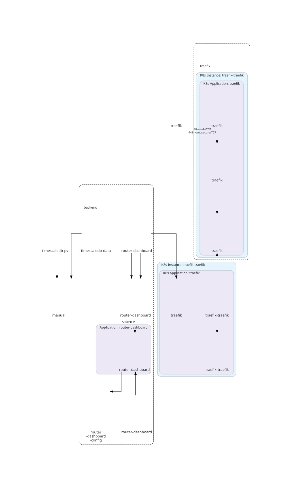

# CPE Router Dashboard

Flask dashboard for Huawei and ZTE router cellular metrics.

Features:

- Live cellular dashboard.
- Historical RSRP, RSRQ, and SINR charts.
- Manual speed test for latency, download, and upload metrics.
- TimescaleDB/PostgreSQL historical storage.
- Plain Kubernetes manifests under `k8s_mani/`.
- GitLab CI for checks, image build, and optional deployment.
- Existing Kubernetes Secret support.
- SOPS/Age-ready secret workflow.
- TLS ingress and LAN/external access notes.
- DNS-free LAN hostname via `router-dashboard.192.168.9.4.sslip.io`.

## Architecture

Kubernetes architecture diagrams for this repository are generated from the local manifests with KubeDiagrams.



## Quick Deploy

Dashboard access requires login. Before deploying an image with account support, configure
`DASHBOARD_SECRET_KEY`, `DASHBOARD_ADMIN_USERNAME`, and `DASHBOARD_ADMIN_PASSWORD` in the existing
Kubernetes Secret. See [Dashboard accounts](docs/authentication.md) for account requests, admin
approval, password changes, and password recovery when the UI is unavailable.

Create or decrypt the Secret first, then apply the app manifests:

```bash
kubectl apply -k k8s_mani
```

The app expects this Secret to already exist:

```text
router-dashboard-secret
```

Router credentials are split by vendor:

```text
HUAWEI_ROUTER_USERNAME
HUAWEI_ROUTER_PASSWORD
ZTE_ROUTER_USERNAME
ZTE_ROUTER_PASSWORD
```

## Router Adapters

The dashboard keeps one application with router-specific code in adapters:

```text
router_clients/
  base.py
  huawei.py
  zte.py
```

Huawei live fetch support uses `/api/device/signal` on `http://192.168.9.1` after the app logs in with `HUAWEI_ROUTER_PASSWORD`. The Huawei login flow is SCRAM-like, but the client signature uses the vendor-specific HMAC argument order used by this router firmware:

1. Fetch the router page and collect CSRF token meta values.
2. POST `/api/user/challenge_login` with username, first nonce, and `mode=1`.
3. Read `salt`, `iterations`, `servernonce`, and the response `__RequestVerificationToken` header.
4. Derive `salted_password = PBKDF2-HMAC-SHA256(password, salt, iterations, dklen=32)`.
5. Compute `client_key = HMAC-SHA256(key="Client Key", message=hex_to_bytes(salted_password_hex))`.
6. Compute `stored_key = SHA256(hex_to_bytes(client_key_hex))`.
7. Build `auth_msg = firstnonce + "," + servernonce + "," + servernonce`.
8. Compute the Huawei-specific signature as `client_signature = HMAC-SHA256(key=auth_msg, message=hex_to_bytes(stored_key_hex))`.
9. XOR `client_key_hex` and `client_signature_hex` to produce `clientproof`.
10. POST `/api/user/authentication_login` with `clientproof` and `finalnonce=servernonce`.

The HMAC order in step 8 is intentional for this Huawei CPE and is not standard SCRAM.

ZTE live fetch support uses `GET /goform/goform_get_cmd_process` on `http://192.168.9.1` after the app logs in with `ZTE_ROUTER_PASSWORD`. Initial normalization maps `network_type`, `lte_rsrp`/`Z5g_rsrp`, `sinr`/`Z5g_SINR`/`Z5g_snr`, `rssi`, `Z_PCI`/`Z5g_PCI`, `cell_id`/`Z5g_CELL_ID`, `ZCELLINFO_band`/`Z5g_CELLINFO_band`, and LTE CA fields into the existing dashboard model.

ZTE login can also use `ZTE_ROUTER_PASSWORD`; for the MF296C firmware at `192.168.9.1`, `ZTE_AUTH_MODE=zte_mf296c` posts `goformId=LOGIN` with `SHA256(SHA256(password) + LD)`. `ZTE_AUTH_MODE=auto` can try other common ZTE transforms, limited by `ZTE_AUTH_AUTO_MAX_ATTEMPTS`.

`ZTE_SESSION_COOKIE` is only a temporary debug override for an already signed-in browser session. It is not the normal authentication path.

Live router data is available from:

```text
/api/cellular?vendor=huawei
/api/cellular?vendor=zte
```

## Docs

- [Dashboard accounts and recovery](docs/authentication.md)

- `docs/deployment.md`
- `docs/secrets.md`
- `docs/configmap.md`
- `docs/certificates-and-access.md`
- `docs/speed-tests.md`

## Kubernetes Diagrams

KubeDiagrams is used here to render architecture diagrams from the Kubernetes manifests under `k8s_mani/`. The generator intentionally uses only explicit non-secret manifest paths; it does not include real Secret manifests, router credentials, database passwords, TLS keys, or private certificate material.

Prerequisites:

- Linux shell environment.
- Python 3.9 or newer.
- Graphviz `dot`.
- KubeDiagrams CLI, which provides `kube-diagrams`.

Install KubeDiagrams for the current user:

```bash
python3 -m pip install --user KubeDiagrams
```

If `python3 -m pip` is unavailable on the VM, bootstrap user-local pip first:

```bash
python3 -m ensurepip --user
python3 -m pip install --user KubeDiagrams
```

Install Graphviz if `dot` is not already available. For example, on Fedora/RHEL-like systems:

```bash
sudo dnf install graphviz
```

Generate diagrams:

```bash
scripts/generate-kube-diagrams.sh
```

Generated files are written to:

```text
docs/diagrams/
```

Expected SVG outputs:

```text
docs/diagrams/backend.svg
docs/diagrams/full-cluster.svg
```

The script also generates optional diagrams when matching non-secret manifests exist:

```text
docs/diagrams/database.svg
docs/diagrams/traefik.svg
docs/diagrams/monitoring.svg
```

If the installed KubeDiagrams version supports Mermaid output, the script also writes `.mmd` files next to the SVG files. Missing optional formats do not fail the run.

### Cellular history profiles

See [cell/sector filtering, chart profile tooltips, loading behavior and tests](docs/history-profiles.md) for issues #25–#27.
